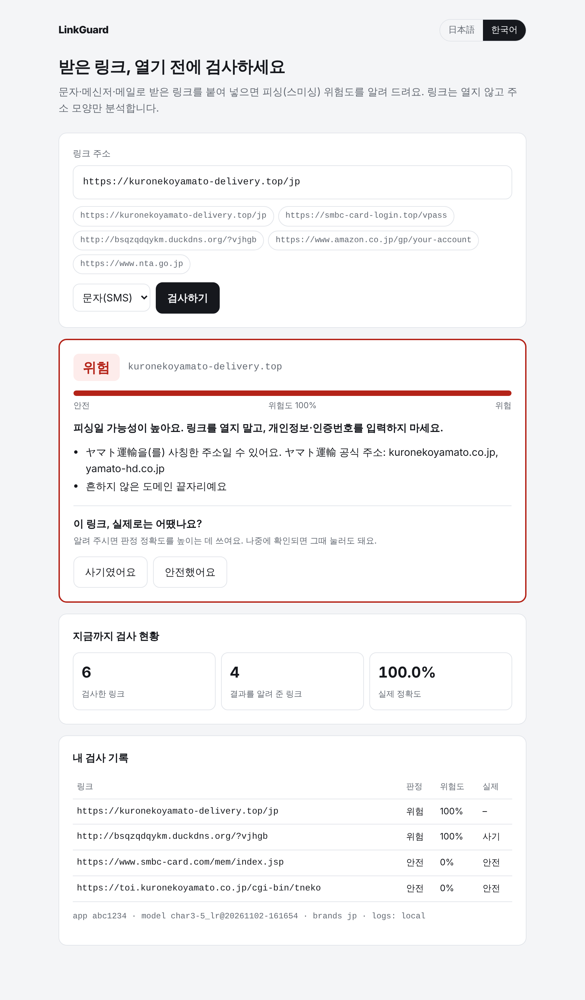

# LinkGuard — 届いたリンク、開く前にチェック (받은 링크, 열기 전에 검사)

## 1. 서비스 정의

> **일본에서 SMS·메신저·메일로 받은 링크를 열기 전에 붙여 넣으면, 택배·카드사·통신사 등을 사칭한 피싱(스미싱) 위험도를 알려 주고, 사용자가 알려 준 실제 결과로 계속 정확해지는 서비스.**

| 항목 | 내용 |
|---|---|
| **누가** | 일본에 사는 스마트폰 이용자 (일본인, 재일 외국인 포함) |
| **어떤 상황에** | 「お荷物のお届けにあがりましたが不在のため持ち帰りました」(택배를 배달하러 왔지만 부재중이라 가져갔습니다) 같은 택배 부재 문자, 카드 이용 확인 문자 등 링크를 받았는데 열어도 되는지 모를 때 |
| **입력** | 링크 주소 1개 (+ 받은 경로, 화면 언어 ja/ko) |
| **예측** | 위험 확률, 3단계 판정(安全/注意/危険 = 안전/주의/위험), 사칭 의심 기관과 그 **공식 주소**, 위험 신호 설명 |
| **정답(사용자 입력)** | 나중에 **「詐欺だった」(사기였어요, 1) / 「安全だった」(안전했어요, 0)** 클릭 |
| **링크를 열지 않음** | 주소 모양만 분석하므로 검사 자체가 위험하지 않음 |

**왜 일본인가** — 공개된 피싱 데이터 중 국가 기관이 직접 확인한 최신 스미싱 데이터(JPCERT/CC)가 일본 대상입니다. 데이터와 사용자가 일치해야 사칭 규칙도 실제 데이터로 검증할 수 있습니다. (한국 대상 공개 피싱 URL 원본은 없음: KISA는 차단 건수 같은 통계만 공개하고 URL은 승인제로 제공. 한국 기관 목록은 `BRAND_REGION=kr`로 남겨 둠)

## 2. 데이터

| 데이터 | 내용 | 신뢰도 | 용도 |
|---|---|---|---|
| [JPCERT/CC 피싱 URL](https://github.com/JPCERTCC/phishurl-list) | 일본 공식 침해사고대응팀이 **확인하고 차단 요청한 피싱 링크** 27만 건 (2019~2026, 사칭 브랜드 기록 포함) | ✅ 공식 기관, 2022년 공식 발표 | 2023년까지 학습, **2024년 이후 평가** |
| [faizann24 URL](https://github.com/faizann24/Using-machine-learning-to-detect-malicious-URLs) | 2017년 무렵 정상·악성 URL 41만 건 | ⚠️ 개인 공개, 수집 방법 미문서화 | 보조 학습 (경로 있는 정상 링크) |
| [인기 사이트 10만](https://github.com/zer0h/top-1000000-domains) | Alexa 순위 기반 도메인 | ⚠️ 비공식·오래됨 | 정상 사이트, 평판 도메인 목록 |

**정규화(학습·서빙 공용)**: 2017년 데이터의 정상 링크는 `https://`, `www.` 없이 저장돼 있어서, 그대로 쓰면 사용자가 붙여 넣는 `https://www.amazon.co.jp`를 처음 보는 모양으로 보고 위험 판정합니다. 학습과 서빙 모두 `normalize()`로 표기 차이를 없앱니다.

## 3. 모델과 평가

**현실 평가셋**: JPCERT **2024년 이후** 피싱 19,896건(학습에 나온 사이트 제외) + 학습에 안 쓴 정상 19,896건, 50:50

| 버전 | 변경 | 결과 | 판단 |
|---|---|---|---|
| v1 | 2017년 데이터, 무작위 분할, 주소 글자 조각 | 0.978 | 90% 후반 → 원인 점검 |
| v2 | 같은 사이트가 학습·테스트에 섞이지 않게 분할 | 0.965 | 여전히 높음 |
| v3 | 2017 모델로 **최신 실제 스미싱** 검사 | 탐지율 0.645 | 데이터가 오래됨 → 현실 평가셋으로 재정의 |
| v3' | 주소 구조 피처 20개 | 탐지율 0.530 | 피처가 아니라 데이터 문제 |

| 학습 데이터 (현실 평가셋) | 정확도 | 사기 탐지율 | 정상 오탐 |
|---|---|---|---|
| A) 2017만 | 0.788 | 0.824 | 24.8% |
| C) + JPCERT 2019~23 | 0.823 | 0.938 | 29.3% (정상까지 사기로 판정) |
| **D) + 인기 사이트** | **0.918** | 0.876 | 4.1% |
| **서비스 (D + 규칙)** | **0.922** | 0.879 | 3.5% |

모델: 정규화된 주소의 글자 3~5개 조각 TF-IDF + 로지스틱 회귀 (`scripts/train.py`)

## 4. 판정 규칙 (`linkguard/policy.py` — API·평가 공용)

```
링크 → 정규화 ─┬─ 1. 정부 도메인 (.go.jp, .lg.jp …)                     → 安全
               ├─ 2. 주요 기관 공식 도메인 (일본 35곳, brands.py)        → 安全
               │     단 live.com·office.com처럼 사용자가 페이지를 올릴 수 있는 곳은 제외(→ 모델)
               ├─ 3. 평판 도메인 (인기 상위 1만 − 피싱 이력 192개)        → 安全
               ├─ 4. 기관 이름을 넣은 비공식 주소 → 사칭 의심              → 危険 + 공식 주소 안내
               └─ 5. 그 외 → 모델 위험 확률  (0.3 미만 安全 / 0.7 미만 注意 / 이상 危険)
```

**일본 관점 평가** (`scripts/evaluate_japan.py`)

| 점검 | 모델만 | 서비스 |
|---|---|---|
| 일본 주요 서비스 공식 주소 26개 (Amazon, 三井住友カード, ヤマト運輸 …) | **19개 注意/危険** | **26개 모두 安全** |
| JPCERT 2024년 이후 실제 피싱 114,556건 중 사칭 규칙에 걸린 비율 | — | 8.2% |
| └ 그중 규칙이 고른 브랜드가 **JPCERT 기록의 실제 사칭 대상과 일치** | — | **97.4%** |
| 학습에 안 쓴 인기 `.jp` 사이트 558개 오탐 | 4.3% | 3.8% |

- 일본 피싱으로 학습한 모델은 유명 브랜드 이름만 보여도 위험으로 기울어요. 그래서 공식 도메인 규칙(2번)이 필수입니다.
- 공식 도메인 중 JPCERT에서 피싱이 실제로 올라간 곳(`outlook.com`, `live.com`, `office.com`, `biglobe.ne.jp`)은 데이터로 찾아 '안전' 처리에서 뺐어요.
- 주요 서비스 26개는 직접 고른 점검용 표본이에요. 일반화된 정확도는 현실 평가셋 수치를 쓰세요.

## 5. API

| 메서드 | 경로 | 설명 |
|---|---|---|
| GET | `/` | 사용자 화면 (日本語 기본, 한국어 전환) |
| POST | `/v1/check` | `{"url": "...", "channel": "sms", "lang": "ja"}` → `verdict`, `risk`, `brand`, `reasons`, `reason_codes`, `check_id` |
| POST | `/v1/feedback` | `{"check_id": "...", "true_label": 1}` (詐欺=1, 安全=0) 또는 `{"is_correct": true}` |
| GET | `/v1/stats` | 검사 수, 신고 수, 신고 기준 실제 정확도 |
| GET | `/health` | 상태, **app_version(배포된 커밋)**, 모델 버전, 브랜드 지역, 로그 싱크 |

**로그** (CloudWatch `/linkguard/app`, S3 `logs/{check,feedback}/dt=YYYY-MM-DD/`): 쿼리 값을 지운 URL, 해시, 판정, 사칭 브랜드, 이유 코드, 모델·앱 버전. `check_id`로 검사와 신고를 이어 붙여 운영 중 정확도를 계산합니다.

## 6. 컨테이너와 배포 → 자세한 내용은 [docs/deploy.md](docs/deploy.md)

```bash
docker compose up --build                       # 로컬: http://localhost:8080
bash infra/create_ec2.sh                        # AWS CLI: EC2 + 보안 그룹 + S3 버킷 (처음 한 번)
S3_BUCKET=<버킷> bash infra/deploy.sh <브랜치>   # AWS CLI + SSH 배포 → /health로 버전 확인
```
- **GitHub Actions** (`.github/workflows/ci-cd.yml`): PR마다 테스트 → 이미지 빌드 → 컨테이너 스모크 테스트. main push 또는 수동 실행 시 GHCR 푸시 → EC2 배포 → 배포 버전 확인
- 인프라: EC2(Amazon Linux 2023, 도쿄 리전) 1대 + Docker Compose, 인스턴스 프로필로 CloudWatch·S3 기록 (키를 서버에 두지 않음)

## 7. 개발

```bash
pip install -r requirements.txt
python scripts/download_data.py && python scripts/train.py && python scripts/evaluate_japan.py
uvicorn app.main:app --port 8000
pytest        # 54개
```

## 8. 화면

| 日本語 | 한국어 |
|---|---|
|  |  |

## 9. 한계와 다음 단계
- **주소만 봅니다.** 정상 사이트 안의 사기 글(SNS 게시글·채팅)은 판별하지 못합니다.
- 공식 도메인 목록(일본 35곳)은 사람이 관리합니다. 출시 전 각 기관 공식 사이트에서 재확인하고, 누락은 신고 로그로 보완합니다.
- 최근 검사 기록·통계는 프로세스 메모리 → 서버를 늘리면 공유 저장소 필요
- 다음 단계: S3 신고 로그를 Athena로 집계 → 정확도 하락 시 재학습 → 같은 CI/CD로 재배포

## 출처
- JPCERT/CC, *Phishing URL dataset*, https://github.com/JPCERTCC/phishurl-list
- Faizan Ahmad, *Using machine learning to detect malicious URLs*, https://github.com/faizann24/Using-machine-learning-to-detect-malicious-URLs
- zer0h, *Top-1000000-Domains*, https://github.com/zer0h/top-1000000-domains
