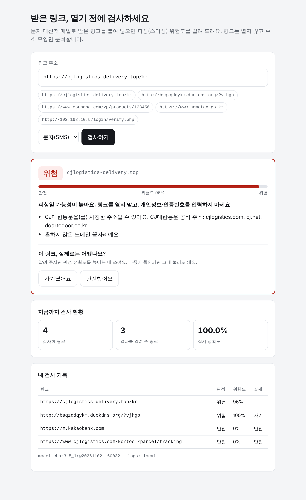

# LinkGuard — 받은 링크, 열기 전에 검사하는 피싱 판정 서비스

## 1. 서비스 정의

> **문자·메신저·메일로 받은 링크를 열기 전에 붙여 넣으면, 피싱(스미싱)·악성 사이트일 위험도를 알려 주고, 사용자가 알려 준 실제 결과로 계속 정확해지는 서비스.**

| 항목 | 내용 |
|---|---|
| **누가** | 스마트폰을 쓰는 누구나 (특히 택배·결제·지원금 문자를 자주 받는 사람) |
| **어떤 상황에** | "택배 주소 확인 바랍니다 http://…" 같은 링크를 받았는데 열어도 되는지 모를 때 |
| **입력** | 링크 주소 1개 (+ 받은 경로: 문자/메신저/메일 등) |
| **예측** | 위험 확률과 3단계 판정(안전 / 주의 / 위험), 눈에 띄는 위험 신호 설명 |
| **정답(사용자 입력)** | 사용자가 나중에 **"사기였어요"(1) / "안전했어요"(0)** 를 누름 — 휴대폰의 스팸 신고처럼 익숙한 동작 |
| **링크를 열지 않음** | 주소 모양만 분석하므로 검사 자체가 위험하지 않음 |

## 2. 데이터

| 데이터 | 내용 | 신뢰도 | 용도 |
|---|---|---|---|
| [JPCERT/CC 피싱 URL](https://github.com/JPCERTCC/phishurl-list) | 일본 공식 침해사고대응팀이 **직접 확인하고 차단 요청한 피싱 링크** 27만 건 (2019~2026, 택배·결제 사칭 스미싱 위주) | ✅ 공식 기관, 2022년 공식 발표 | 2023년까지 학습, **2024년 이후는 평가** |
| [faizann24 URL 데이터](https://github.com/faizann24/Using-machine-learning-to-detect-malicious-URLs) | 2017년 무렵 정상·악성 URL 41만 건 | ⚠️ 개인 공개, 수집·라벨 방법 미문서화 | 보조 학습 (경로가 붙은 정상 링크는 사실상 여기에만 있음) |
| [인기 사이트 10만](https://github.com/zer0h/top-1000000-domains) | Alexa 순위 기반 인기 사이트 도메인 | ⚠️ 비공식·오래됨 | 요즘 정상 사이트, 평판 도메인 목록 |

### 왜 한국 데이터가 아니라 일본(JPCERT) 데이터인가
- **누구나 받을 수 있는 한국 피싱 URL 원본 데이터는 없습니다.** KISA(한국인터넷진흥원)는 공공데이터포털에 차단 *건수* 같은 통계만 공개하고, URL 원본은 악용 우려 때문에 기관 승인을 거쳐서만 제공합니다.
- 피싱 수법과 인프라는 국경을 넘어 같습니다. 택배 배송조회 사칭(일본 야마토 ↔ 한국 CJ대한통운), `.top`·`.cfd` 같은 저가 도메인, 무료 동적 DNS(duckdns) 등이 그렇습니다. JPCERT는 공개 데이터 중 **국가 기관이 확인한 최신 스미싱 데이터**입니다.
- 한국 특화는 두 가지로 보완합니다.
  1. **한국 기관 사칭 규칙**(`linkguard/korea_brands.py`): 자주 사칭되는 기관 24곳의 공식 도메인 목록 → 공식이면 안전, 이름만 흉내 내면 사칭 경고 (5장)
  2. **한국 사용자 신고 로그**: "사기였어요/안전했어요" 신고를 CloudWatch·S3에 모아 한국 스미싱으로 재학습 — 과제 5번(정답 로그 수집)의 핵심 목적

**정규화(학습·서빙 공용)**: 2017년 데이터의 정상 링크는 전부 `https://`, `www.` 없이 경로가 붙은 형태로 저장돼 있었습니다. 그대로 쓰면 사용자가 붙여 넣는 `https://www.naver.com`을 "처음 보는 모양"으로 보고 위험 판정합니다. 그래서 학습과 서빙 모두 `normalize()`로 표기 차이를 없앱니다.

## 3. 평가 방법 — "지금 사용자가 받는 링크"를 흉내 낸 현실 평가셋

- **사기 링크**: JPCERT **2024년 이후** 피싱 19,896건. 학습(2023년까지)에 나온 사이트는 제외 → **미래의, 처음 보는 사기 링크**
- **정상 링크**: 학습에 안 쓴 사이트 19,896건 (2017년 정상 링크 + 인기 사이트)
- 50:50, 학습과 겹치는 사이트 없음

## 4. 모델 실험 기록 (과제 3-1, 3-2)

| 버전 | 변경 | 결과 | 판단 |
|---|---|---|---|
| v1 | 2017년 데이터, 무작위 분할, 주소 글자 조각 | 0.978 | **90% 후반** → 원인 점검 |
| v2 | 같은 사이트가 학습·테스트에 섞이지 않게 분할 | 0.965 | 여전히 높음 |
| v3 | 2017년 모델로 **최신 실제 스미싱** 검사 | 탐지율 **0.645** | 데이터가 오래돼서 요즘 사기 링크를 놓침 → **평가 방법 재정의** (현실 평가셋) |
| v3' | 사이트 이름 대신 주소 구조 피처 20개 | 최신 스미싱 탐지율 0.530 | 더 나쁨 → 피처 문제가 아니라 **데이터 문제** |

**현실 평가셋 결과 (데이터 조합별)**

| 학습 데이터 | 정확도 | 사기 탐지율 | 정상 오탐 | 인기 사이트 오탐 |
|---|---|---|---|---|
| A) 2017년 데이터만 | 0.788 ❌ | 0.824 | 24.8% | 45.8% |
| C) A + 최신 피싱(2019~23) | 0.823 ❌ | **0.938** | 29.3% | **56.1%** — 처음 보는 건 다 사기로 판정 |
| **D) C + 요즘 인기 사이트** | **0.918** ✅ | 0.876 | 4.1% | 6.4% |

- 최신 피싱만 넣으면 탐지율은 오르지만, **정상 사이트까지 사기로 판정**해서 오히려 쓸 수 없습니다. 요즘 정상 사이트를 함께 넣어야 균형이 잡힙니다.
- 학습 정확도 0.977과 평가 정확도 0.918의 차이는 과적합이 아니라 **평가셋이 미래의 처음 보는 링크**이기 때문입니다.

**최종 서비스 (규칙 + 모델)**

| Accuracy | Precision | 사기 탐지율 (Recall) | F1 | 정상 오탐 |
|---|---|---|---|---|
| **0.920** | 0.961 | 0.876 | 0.917 | 3.5% |

## 5. 판정 흐름 (`linkguard/policy.py` — API와 평가가 같은 코드 사용)

```
링크 → 정규화 ─┬─ 1. 정부·공공 도메인 (.go.kr, gov.kr, .gov …)          → 안전 (개인이 등록 불가)
               ├─ 2. 한국 주요 기관 공식 도메인 (24곳)                    → 안전
               ├─ 3. 평판 도메인 (인기 상위 1만 − 피싱 이력 192개 제외)    → 안전
               ├─ 4. 기관 이름을 넣은 비공식 주소 (사칭 의심)              → 위험 (+ 진짜 공식 주소 안내)
               └─ 5. 그 외 → 모델(주소 글자 3~5개 조각 + 로지스틱 회귀)   → 위험 확률
                             0.3 미만 안전 / 0.3~0.7 주의 / 0.7 이상 위험
```

- **평판 도메인 목록은 데이터로 만듭니다.** 인기 상위 1만 개 중 학습 데이터에서 **피싱이 올라간 적 있는 도메인**(`github.io`, `blogspot.com`, `duckdns.org`, `weebly.com` 등 누구나 페이지를 만들 수 있는 곳)은 자동 제외합니다. 현실 평가셋에서 규칙 때문에 통과된 사기 링크는 19,896건 중 9건입니다.
- **왜 2번(기관 공식 도메인)이 필요했나**: 모델만 쓰면 **진짜 CJ대한통운 배송조회 페이지가 위험 0.97**이었습니다. JPCERT에 택배 조회 사칭이 워낙 많아서 "택배 + 조회" 모양을 위험으로 배운 탓입니다.
- **사칭 판정(4번)**: 호스트를 `.`·`-`로 나눈 조각이 기관 키워드와 맞으면 사칭 의심입니다. 짧은 키워드(6글자 이하)는 정확히 같을 때만 인정해 `ibkr.com`, `tossup.com`, `hanjinshipping.com` 같은 무관한 사이트를 잡지 않습니다. 평판 도메인 확인(3번)을 먼저 해서 계열사 실제 사이트도 보호합니다.

### 한국 사용자 관점 평가 (`scripts/evaluate_korea.py`)

| 대상 | 모델만 | 서비스 (규칙 + 모델) |
|---|---|---|
| 학습에 안 쓴 인기 `.kr` 사이트 55개 | 오탐 0%, 주의 5.5% | 오탐 0%, 주의 3.6% |
| 한국 주요 서비스 실제 주소 26개 (포털·은행·쇼핑·택배·통신·공공) | **7개 주의/위험** (CJ대한통운 0.97, 신한은행 0.36, 카카오뱅크 0.33 …) | **26개 모두 안전** |
| 한국 기관 사칭 형태 예시 8개 (`cjlogistics-delivery.top`, `kakaobank-login.top` …) | 8개 위험 | 8개 위험 + 사칭 기관·공식 주소 안내 |

※ 주요 서비스와 사칭 예시 목록은 직접 고른 점검용 표본이라 일반화된 정확도는 아닙니다. 실제 한국 스미싱에서의 성능은 신고 로그로 측정합니다.

## 6. API

| 메서드 | 경로 | 설명 |
|---|---|---|
| GET | `/` | 사용자 화면 |
| POST | `/v1/check` | `{"url": "...", "channel": "sms"}` → `verdict`, `risk`, `reasons`, `check_id` |
| POST | `/v1/feedback` | `{"check_id": "...", "true_label": 1}` (사기였음=1, 안전했음=0) 또는 `{"is_correct": true}` |
| GET | `/v1/stats` | 검사 수, 결과를 알려 준 수, **사용자 기준 실제 정확도** |
| GET | `/health` | 상태, 모델 버전, 로그 싱크 |

### 수집되는 로그 (JSON 한 줄)
```json
{"event": "check", "check_id": "78c9…", "ts": "2026-10-26T09:21:58.395+00:00",
 "url_redacted": "coupang-event.shop/gift?id=*", "url_sha256": "faf51e…", "host": "coupang-event.shop",
 "channel": "sms", "stage": "model", "pred_label": 1, "risk": 0.9799, "model_risk": 0.9799,
 "verdict": "위험", "model_version": "char3-5_lr@20261026-182114", "latency_ms": 2.33}
{"event": "feedback", "check_id": "78c9…", "ts": "2026-10-26T09:21:59.008+00:00",
 "pred_label": 1, "true_label": 1, "is_correct": true, "model_version": "char3-5_lr@20261026-182114"}
```
- `check_id`로 검사와 실제 결과를 이어 붙여 **운영 중 정확도**를 계산합니다.
- **개인정보 보호**: 링크의 쿼리 값(`?phone=010…`, 인증 토큰 등)은 지우고 저장합니다. 같은 링크인지 비교할 수 있도록 원본은 해시(`url_sha256`)로만 남깁니다.
- `model_risk`: 규칙으로 '안전' 처리된 경우에도 모델 점수를 남겨, 평판 목록이 틀리는 경우를 나중에 찾을 수 있게 합니다.

## 7. 실행

```bash
pip install -r requirements.txt
python scripts/download_data.py     # data/ (약 50MB)
python scripts/train.py             # models/model.joblib, reputable_domains.txt, metrics.json (약 5분)
uvicorn app.main:app --port 8000    # http://localhost:8000
python scripts/evaluate_korea.py    # 한국 사이트·사칭 예시 점검 → models/metrics_korea.json
pytest                              # 48개 (AWS 로그는 moto 가짜 AWS로 검증)
```

### AWS 로그 수집 켜기 (CloudWatch + S3)
1. 자격 증명: `aws configure` 또는 환경변수 (`AWS_ACCESS_KEY_ID`, `AWS_SECRET_ACCESS_KEY`, AWS Academy는 `AWS_SESSION_TOKEN`까지). EC2라면 IAM 역할로 대체 가능
2. S3 버킷 만들기 (이름은 전 세계에서 유일해야 함)
   ```bash
   aws s3 mb s3://linkguard-logs-<본인이름> --region ap-northeast-2
   ```
3. 실행
   ```bash
   export AWS_DEFAULT_REGION=ap-northeast-2
   export LOG_SINKS=local,cloudwatch,s3
   export S3_BUCKET=linkguard-logs-<본인이름>
   uvicorn app.main:app --host 0.0.0.0 --port 8000
   ```
   로그 그룹 `/linkguard/app`은 앱이 처음 뜰 때 자동으로 만듭니다.
4. 확인: CloudWatch 콘솔 → 로그 그룹 `/linkguard/app` / S3 콘솔 → `logs/check/`, `logs/feedback/` (`dt=날짜` 폴더)

필요 권한: `logs:CreateLogGroup`, `logs:CreateLogStream`, `logs:PutLogEvents`, `s3:PutObject`

Docker:
```bash
docker build -t linkguard .
docker run -p 8000:8000 -e LOG_SINKS=local,cloudwatch,s3 -e S3_BUCKET=... -e AWS_DEFAULT_REGION=ap-northeast-2 \
  -e AWS_ACCESS_KEY_ID -e AWS_SECRET_ACCESS_KEY -e AWS_SESSION_TOKEN linkguard
```

## 8. 화면



## 9. 한계와 다음 단계
- **주소만 봅니다.** 정상 사이트 안의 사기 글(예: 오픈채팅방, 게시글)은 판별하지 못합니다.
- 평판·기관 목록 밖의 정상 사이트(예: GitHub 저장소 주소 0.62)는 '주의'가 나올 수 있습니다. → 사용자가 "안전했어요"를 누른 기록을 모아 재학습
- 학습 데이터의 피싱은 일본 대상입니다. 한국 스미싱(택배·지원금 사칭)에서의 실제 정확도는 사용자 신고 로그로 측정해야 합니다.
- 한국 기관 공식 도메인 목록(24곳)은 사람이 관리합니다. 출시 전 각 기관 공식 홈페이지에서 재확인하고, 누락은 신고 로그로 보완합니다.
- 최근 검사 기록과 통계는 프로세스 메모리 → 여러 인스턴스로 늘리면 공유 저장소 필요
- 다음 단계: S3의 신고 로그를 Athena로 집계 → 정확도가 떨어지면 신고 데이터를 더해 재학습

## 출처
- JPCERT/CC, *Phishing URL dataset*, https://github.com/JPCERTCC/phishurl-list
- Faizan Ahmad, *Using machine learning to detect malicious URLs*, https://github.com/faizann24/Using-machine-learning-to-detect-malicious-URLs
- zer0h, *Top-1000000-Domains*, https://github.com/zer0h/top-1000000-domains
