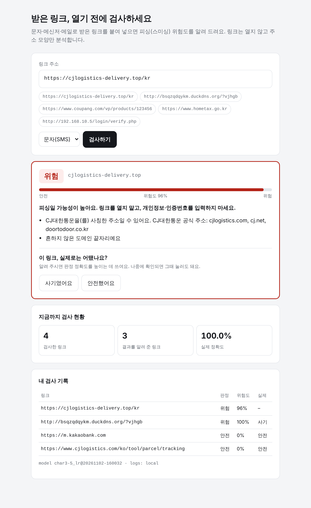
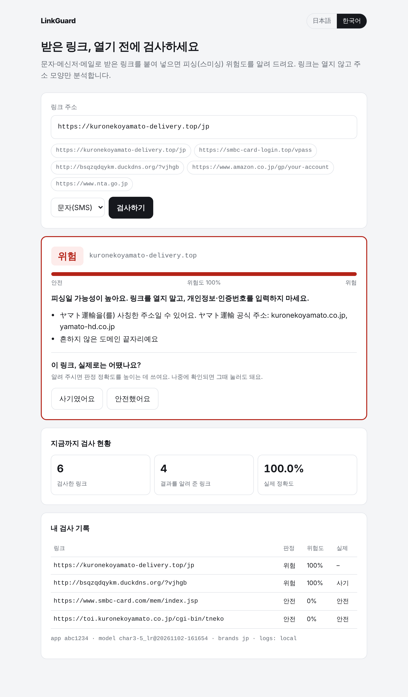

# LinkGuard — 받은 링크, 열기 전에 검사 (届いたリンク、開く前にチェック)

> **처음 받아서 실행·배포하려면 → [docs/handover.md](docs/handover.md)** (fork → CloudShell 명령 두 줄 → 동작 확인)

## 1. 서비스 정의

> **한국·일본에 사는 스마트폰 이용자가 문자·메신저·메일로 받은 링크를 열기 전에 붙여 넣으면, 택배·카드사·공공기관 등을 사칭해 개인정보나 돈을 노리는 피싱인지 주소만 보고 판정해 알려 주고(사칭 기관이 드러나면 공식 주소도 안내), 사용자 신고로 계속 개선되는 서비스.**

| 항목 | 내용 |
|---|---|
| **누가** | 한국·일본에 사는 스마트폰 이용자 (일본에 사는 한국인 포함). 화면 언어 日本語 / 한국어 |
| **어떤 상황에** | 링크가 담긴 문자를 받았는데 열어도 되는지 모를 때<br>· 일본: 「お荷物のお届けにあがりましたが不在のため持ち帰りました」(택배를 배달하러 왔지만 부재중이라 가져갔습니다)<br>· 한국: "[CJ대한통운] 주소 불일치로 배송이 보류되었습니다. 주소 수정: http://…" |
| **입력** | 링크 주소 1개 (+ 받은 경로, 화면 언어 ja/ko) |
| **예측** | 위험 확률, 3단계 판정(安全/注意/危険 = 안전/주의/위험), 위험 신호 설명. 주소에서 사칭 기관이 드러나면 그 기관의 **공식 주소** |
| **정답(사용자 입력)** | 나중에 **「詐欺だった」/ 사기였어요 (1)**, **「安全だった」/ 안전했어요 (0)** 클릭 → 검역·카나리 검사를 거쳐 재학습에 반영 |
| **링크를 열지 않음** | 주소 모양만 분석하므로 검사 자체가 위험하지 않음 |

### "사기"의 범위 — 신고 기준이기도 함
| 사기(1)로 본다 | 사기로 보지 않는다 (서비스 대상 아님) |
|---|---|
| 기관·브랜드를 사칭해 **로그인 정보·카드 번호·송금**을 노리는 피싱 (택배, 카드사, 은행, 통신사, 공공기관, 쇼핑몰 사칭) | 성인 사이트, 불법 스트리밍, 도박 등 **유해하지만 사칭이 아닌** 사이트 |
| 유명 도메인을 흉내 낸 오타 도메인 (`gooogle.com`, `yotube.com`) | 정상 서비스 안의 게시물·채널 (`t.me/…`, SNS 글) — 주소만으로 판단 불가 |
| | 바이러스·악성 파일 유포 사이트 — 페이지 내용을 봐야 알 수 있음 |

### 데이터와 대상의 차이 (한계)
- **일본**: 국가 기관(JPCERT/CC)이 확인한 최신 피싱 27만 건으로 학습·평가. 사칭 기관 상위 35곳이 실제 피싱의 84%를 차지하고, 그 대부분을 공식 주소 목록에 등록.
- **한국**: 한국 대상 공개 피싱 URL 원본이 없음 (KISA는 통계만 공개, URL은 승인제). 그래서 **한국 기관 공식 주소 규칙 + 사용자 신고 재학습**으로 보완하고, 한국 판정 성능은 별도 점검 세트로 확인.

## 2. 데이터

| 데이터 | 내용 | 신뢰도 | 용도 |
|---|---|---|---|
| [JPCERT/CC 피싱 URL](https://github.com/JPCERTCC/phishurl-list) | 일본 공식 침해사고대응팀이 **확인하고 차단 요청한 피싱 링크** 27만 건 (2019~2026, 사칭 브랜드 기록 포함) | ✅ 공식 기관, 2022년 공식 발표 | 2023년까지 학습, **2024년 이후 평가** |
| [faizann24 URL](https://github.com/faizann24/Using-machine-learning-to-detect-malicious-URLs) | 2017년 무렵 정상·악성 URL 41만 건 | ⚠️ 개인 공개, 수집 방법 미문서화 | 보조 학습 (경로 있는 정상 링크) |
| [인기 사이트 10만](https://github.com/zer0h/top-1000000-domains) | Alexa 순위 기반 도메인 | ⚠️ 비공식·오래됨 | 정상 사이트, 평판 도메인 목록 |

**정규화(학습·서빙 공용)**: 2017년 데이터의 정상 링크는 `https://`, `www.` 없이 저장돼 있어서, 그대로 쓰면 사용자가 붙여 넣는 `https://www.amazon.co.jp`를 처음 보는 모양으로 보고 위험 판정합니다. 학습과 서빙 모두 `normalize()`로 표기 차이를 없앱니다.

## 3. 모델과 평가

**현실 평가셋**: JPCERT **2024년 이후** 피싱 19,896건(학습에 나온 사이트 제외) + 학습에 안 쓴 정상 19,896건, 50:50

| 버전 | 변경 | 결과 | 판단 |
|---|---|---|---|
| v1 | 2017년 데이터, 무작위 분할, 주소 글자 조각 | 0.978 | 90% 후반 → 원인 점검 |
| v2 | 같은 사이트가 학습·테스트에 섞이지 않게 분할 | 0.965 | 여전히 높음 |
| v3 | 2017 모델로 **최신 실제 스미싱** 검사 | 탐지율 0.645 | 데이터가 오래됨 → 현실 평가셋으로 재정의 |
| v3' | 주소 구조 피처 20개 | 탐지율 0.530 | 피처가 아니라 데이터 문제 |

| 학습 데이터 (현실 평가셋) | 정확도 | 사기 탐지율 | 정상 오탐 |
|---|---|---|---|
| A) 2017만 | 0.788 | 0.824 | 24.8% |
| C) + JPCERT 2019~23 | 0.823 | 0.938 | 29.3% (정상까지 사기로 판정) |
| **D) + 인기 사이트** | **0.918** | 0.876 | 4.1% |
| **서비스 (D + 규칙)** | **0.922** | 0.879 | 3.5% |

모델: 정규화된 주소의 글자 3~5개 조각 TF-IDF + 로지스틱 회귀 (`scripts/train.py`)

## 4. 판정 규칙 (`linkguard/policy.py` — API·평가 공용)

```
링크 → 정규화 ─┬─ 0. 쿼리에 다른 사이트 주소를 품은 전달 링크 (넘어가는 곳이 1~3번이 아니면) → 注意 이상 + 넘어가는 곳 안내
               │     예: cc.naver.com/cc?…&u=https://(피싱) — JPCERT 실제 사례, 공식 도메인이어도 안전 처리 안 함
               ├─ 1. 정부 도메인 (.go.jp, .lg.jp, .go.kr …)              → 安全
               ├─ 2. 주요 기관 공식 도메인 (일본 39곳 + 한국 24곳, brands.py, BRAND_REGION=jp,kr) → 安全
               │     단 live.com·office.com처럼 사용자가 페이지를 올릴 수 있는 곳은 제외(→ 모델)
               ├─ 3. 평판 도메인 (인기 상위 1만 − 피싱 이력 192개)        → 安全
               ├─ 4. 기관 이름을 넣은 비공식 주소 → 사칭 의심              → 危険 + 공식 주소 안내
               └─ 5. 그 외 → 모델 위험 확률  (0.3 미만 安全 / 0.7 미만 注意 / 이상 危険)
```

**일본 관점 평가** (`scripts/evaluate_japan.py`)

| 점검 | 모델만 | 서비스 |
|---|---|---|
| 일본 주요 서비스 공식 주소 26개 (Amazon, 三井住友カード, ヤマト運輸 …) | **19개 注意/危険** | **26개 모두 安全** |
| JPCERT 2024년 이후 실제 피싱 114,556건 중 사칭 규칙에 걸린 비율 | — | 8.7% (11/16 기관 4곳 추가 전 8.2%) |
| └ 그중 규칙이 고른 브랜드가 **JPCERT 기록의 실제 사칭 대상과 일치** | — | **97.2%** |
| 공식 도메인이라 안전 처리된 실제 피싱 | — | **0건** (네이버 전달 링크 2건은 0번 규칙으로 주의) |
| 학습에 안 쓴 인기 `.jp` 사이트 558개 오탐 | 4.3% | 3.8% |

- 일본 피싱으로 학습한 모델은 유명 브랜드 이름만 보여도 위험으로 기울어요. 그래서 공식 도메인 규칙(2번)이 필수입니다.
- 공식 도메인 중 JPCERT에서 피싱이 실제로 올라간 곳(`outlook.com`, `live.com`, `office.com`, `biglobe.ne.jp`)은 데이터로 찾아 '안전' 처리에서 뺐어요.
- 주요 서비스 26개는 직접 고른 점검용 표본이에요. 일반화된 정확도는 현실 평가셋 수치를 쓰세요.

**한국 관점 점검** (`scripts/evaluate_korea.py`) — 한국 공개 피싱 데이터가 없어 직접 고른 점검 세트

| 점검 | 일본 규칙만 (11/9까지 배포 설정) | 일본+한국 규칙 (현재) |
|---|---|---|
| 한국 주요 서비스 40곳 (은행·카드·택배·통신·공공·쇼핑·게임) 중 주의/위험 | **8곳** (KB국민카드 87%, 한진택배 85% …) | **0곳** |
| 한국 기관 사칭 예시 15개 중 위험 / 공식 주소 안내 | 15 / 0 | 15 / **15** |

- 사칭 예시는 패턴을 흉내 내 만든 주소예요. 신고 데이터에 비슷한 주소가 있어 **탐지율의 근거로 쓰지 않습니다.**
- 오탐 8곳은 모두 한국 목록에 등록된 기관이라 규칙으로 고쳐졌어요. 목록에 없는 한국 사이트는 카나리(11번가·G마켓·쿠팡·다음·배민)로 지켜요.

## 5. API

| 메서드 | 경로 | 설명 |
|---|---|---|
| GET | `/` | 사용자 화면 (日本語 기본, 한국어 전환) |
| POST | `/v1/check` | `{"url": "...", "channel": "sms", "lang": "ja"}` → `verdict`, `risk`, `brand`, `reasons`, `reason_codes`, `check_id` |
| POST | `/v1/feedback` | `{"check_id": "...", "true_label": 1}` (詐欺=1, 安全=0) 또는 `{"is_correct": true}` |
| GET | `/v1/stats` | 검사 수, 신고 수, 신고 기준 실제 정확도 |
| GET | `/health` | 상태, **app_version(배포된 커밋)**, 모델 버전, 브랜드 지역, 로그 싱크 |

**로그** (CloudWatch `/linkguard/app`, S3 `logs/{check,feedback}/dt=YYYY-MM-DD/`): 쿼리 값을 지운 URL, 해시, 판정, 사칭 브랜드, 이유 코드, 모델·앱 버전. `check_id`로 검사와 신고를 이어 붙여 운영 중 정확도를 계산합니다.

## 6. 컨테이너와 배포 → 자세한 내용은 [docs/deploy.md](docs/deploy.md)

```bash
docker compose up --build                       # 로컬: http://localhost:8080
bash infra/up.sh                                # CloudShell: EC2 생성 + GitHub Secrets 갱신 + Actions 배포 (매주 초기화 후 이것만)
bash infra/create_ec2.sh                        # AWS CLI: EC2 + 보안 그룹 + S3 버킷만
S3_BUCKET=<버킷> bash infra/deploy.sh <브랜치>   # AWS CLI + SSH 배포 → /health로 버전 확인
```
- **GitHub Actions** (`.github/workflows/ci-cd.yml`): PR마다 테스트 → 이미지 빌드 → 컨테이너 스모크 테스트. main push 또는 수동 실행 시 GHCR 푸시 → EC2 배포 → 배포 버전 확인
- 인프라: EC2(Amazon Linux 2023, 도쿄 리전) 1대 + Docker Compose, 인스턴스 프로필로 CloudWatch·S3 기록 (키를 서버에 두지 않음)

## 6-1. 신고 로그 → 재학습 → 재배포 (`.github/workflows/retrain.yml`)

```
사용자 신고(詐欺だった/安全だった) → CloudWatch /linkguard/app
  → CloudShell: aws logs filter-log-events … > logs/cloudwatch.json
  → python3 scripts/prepare_feedback.py logs/cloudwatch.json   (check+feedback 결합, 장난 주소 제외, 다수결)
  → data/feedback/feedback_YYYYMMDD.csv push
  → Actions retrain: 재학습(E = D + 신고, 가중치 100) → 품질 게이트 → 일본 관점 평가 → 테스트 → 모델 커밋 → ci-cd 배포
```

| 신고 가중치 | 현실 평가셋 정확도 | 오탐 | 신고 37개 중 정답 |
|---|---|---|---|
| 0 (신고 미반영) | 0.915 | 4.2% | 28 |
| 20 | 0.916 | 4.5% | 36 |
| **100 (채택)** | **0.919** | **3.7%** | **37** |
| 300 | 0.910 | 4.5% | 37 |

- **품질 게이트**: 직전 모델보다 서비스 정확도가 1%p 넘게 떨어지거나 오탐이 1%p 넘게 오르면 모델을 바꾸지 않고 실패 → 배포 안 됨
- **신고 오염 방지 (11/9 사고 후 추가)**: 누군가 `google.com/search`를 사기로 신고 → 재학습 모델이 구글 검색을 54~89%로 판정했는데, 평가셋 평균엔 티가 안 나 게이트를 통과해 배포됨
  - **검역**: 인기 사이트 본체를 사기로, 인기 사이트가 아닌 피싱 이력 도메인을 안전으로 신고한 건은 학습 제외 → 검토 대상 (이번 13건: 구글 검색, 성인 사이트, bit.ly)
  - **카나리**: 반드시 안전 11개(구글 검색·유튜브·네이버 …) / 반드시 위험 5개를 하나라도 어기면 배포 차단. 사고 난 모델에 돌리면 2개 실패로 차단됨
  - 결과: 서비스 정확도 0.9194 → 0.9212, 오탐 3.65% → 3.35%, 카나리 16/16 통과
- 신고 주소 정답 수는 학습에 넣은 데이터라 **반영 확인용**이지 일반화 성능이 아닙니다. 예: 신고한 `gooogle.com`은 고쳐지지만 처음 보는 `gogle.com`은 여전히 못 잡음 → 오타 사칭은 규칙이 필요

## 7. 개발

```bash
pip install -r requirements.txt
python scripts/download_data.py && python scripts/train.py && python scripts/evaluate_japan.py
uvicorn app.main:app --port 8000
pytest        # 54개
```

## 8. 화면

| 日本語 | 한국어 |
|---|---|
|  |  |

## 9. 한계와 다음 단계
- **주소만 봅니다.** 정상 사이트 안의 사기 글(SNS 게시글·채팅)은 판별하지 못합니다.
- 공식 도메인 목록(일본 35곳)은 사람이 관리합니다. 출시 전 각 기관 공식 사이트에서 재확인하고, 누락은 신고 로그로 보완합니다.
- 최근 검사 기록·통계는 프로세스 메모리 → 서버를 늘리면 공유 저장소 필요
- 다음 단계: S3 신고 로그를 Athena로 집계 → 정확도 하락 시 재학습 → 같은 CI/CD로 재배포

## 출처
- JPCERT/CC, *Phishing URL dataset*, https://github.com/JPCERTCC/phishurl-list
- Faizan Ahmad, *Using machine learning to detect malicious URLs*, https://github.com/faizann24/Using-machine-learning-to-detect-malicious-URLs
- zer0h, *Top-1000000-Domains*, https://github.com/zer0h/top-1000000-domains
