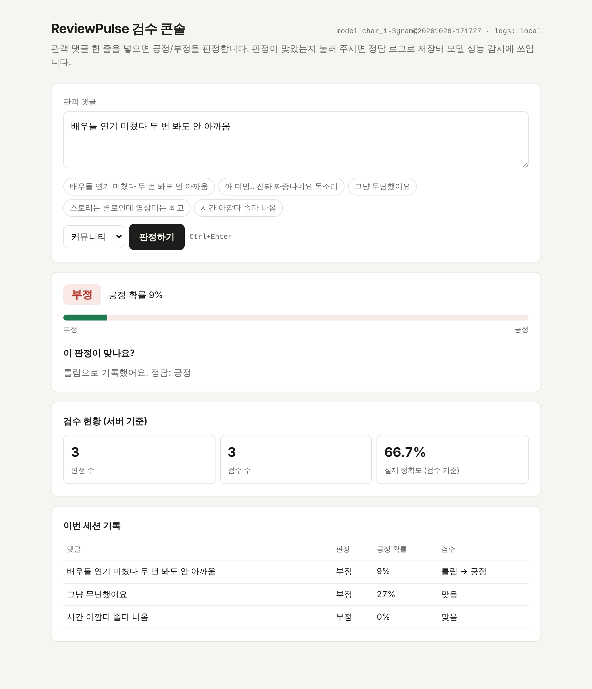

# ReviewPulse — 영화 관객 반응 실시간 판정 & 검수 로그 수집

## 1. 서비스 정의

> **영화 배급사·마케팅 담당자가 개봉 직후 커뮤니티·SNS에 올라오는 별점 없는 관객 댓글을 긍정/부정으로 자동 판정해, 부정 여론이 커지는 순간을 빠르게 알아채도록 돕는 서비스.**

| 항목 | 내용 |
|---|---|
| **누가** | 영화 배급사·마케팅팀 담당자 |
| **어떤 상황에** | 개봉 첫 주처럼 커뮤니티·유튜브·기사 댓글이 수만 건씩 쏟아지는데 별점이 없어 반응을 수치로 볼 수 없을 때 |
| **입력** | 관객 댓글 한 줄 (한국어 텍스트) + 출처(커뮤니티/유튜브/기사/SNS) |
| **예측** | 긍정/부정, 긍정 확률, 검수 권장 여부(확률 0.35~0.65) |
| **정답(사용자 입력)** | 담당자가 검수 화면에서 **맞아요/틀려요(T/F)** 클릭 → 실제 라벨로 변환해 저장 |
| **얻는 것** | 사람이 다 읽지 않고도 부정 반응 비율을 파악하고, 급증 시 원인 댓글만 골라 대응(상영관·홍보 조정 등) |

## 2. 데이터와 모델

- **데이터**: [NSMC](https://github.com/e9t/nsmc) 네이버 영화 리뷰 20만 건 (공식 학습 15만 / 테스트 5만, 긍정·부정 50:50)
- **피처**: 리뷰 문장 → TF-IDF, **라벨**: 1=긍정, 0=부정
- **모델**: 로지스틱 회귀

| 단계 | 피처 | 검증 정확도 | 판단 |
|---|---|---|---|
| 기준선 | 전부 한쪽으로 찍기 | 0.501 | — |
| v1 | 단어(띄어쓰기) 1~2개 묶음 | 0.815 | **기준(0.85) 미달** → 피처 조정 |
| **v2** | **글자 1~3개 조각** | **0.866** | 채택 |

한국어 댓글은 띄어쓰기·줄임말이 제각각이라 단어 단위로는 `짜증나네요`·`짜증남`·`짜증`이 서로 다른 단어가 됩니다. 글자 조각으로 바꾸면 공통 조각(`짜증`)을 공유해 정확도가 올라갑니다.

**최종 (공식 테스트셋 49,997건, 학습에 쓰지 않은 데이터)**

| Accuracy | Precision | Recall | F1 | Train Acc |
|---|---|---|---|---|
| **0.868** | 0.874 | 0.862 | 0.868 | 0.898 |

- 설정은 학습셋 10%를 떼어 만든 검증셋으로 골랐고, 테스트셋은 마지막에 한 번만 사용
- 알려진 약점: 부정 표현을 뒤집는 문장(`두 번 봐도 안 아까움` → 긍정인데 부정으로 판정). 이런 오답을 검수 로그로 모아 재학습에 활용

## 3. 구성

```
브라우저(검수 화면) ──▶ FastAPI ──▶ 모델(models/model.joblib)
                          │
                          └─▶ 로그 수집 (prediction / feedback 이벤트)
                                ├─ local      logs/events.jsonl
                                ├─ CloudWatch /reviewpulse/app
                                └─ S3         s3://버킷/logs/{event}/dt=YYYY-MM-DD/*.json
```

| 메서드 | 경로 | 설명 |
|---|---|---|
| GET | `/` | 담당자용 검수 화면 |
| POST | `/v1/predict` | `{"text": "...", "source": "community"}` → 긍정/부정, 확률, `prediction_id` |
| POST | `/v1/feedback` | `{"prediction_id": "...", "is_correct": true}` 또는 `{"true_label": 1}` |
| GET | `/v1/stats` | 판정 수, 검수 수, **검수 기준 실제 정확도** |
| GET | `/health` | 상태, 모델 버전, 활성 로그 싱크 |

### 수집되는 로그 (JSON 한 줄)
```json
{"event": "prediction", "prediction_id": "617c…", "ts": "2026-10-26T08:19:47.808+00:00",
 "text": "배우들 연기 미쳤다 두 번 봐도 안 아까움", "source": "community",
 "pred_label": 0, "prob_positive": 0.0943, "needs_review": false,
 "model_version": "char_1-3gram@20261026-171727", "latency_ms": 1.44}
{"event": "feedback", "prediction_id": "617c…", "ts": "2026-10-26T08:19:48.373+00:00",
 "pred_label": 0, "true_label": 1, "is_correct": false, "model_version": "char_1-3gram@20261026-171727"}
```
`prediction_id`로 예측과 정답을 이어 붙이면 **운영 중 실제 정확도**를 계산할 수 있습니다.

## 4. 실행

```bash
pip install -r requirements.txt
python scripts/download_data.py      # data/nsmc_*.txt
python scripts/train.py              # models/model.joblib, models/metrics.json
uvicorn app.main:app --port 8000     # http://localhost:8000
pytest                               # 13개 (AWS 로그는 moto로 가짜 AWS에서 검증)
```

### AWS 로그 수집 켜기 (CloudWatch + S3)

1. **자격 증명**: `aws configure` 또는 환경변수(`AWS_ACCESS_KEY_ID`, `AWS_SECRET_ACCESS_KEY`, AWS Academy는 `AWS_SESSION_TOKEN`까지). EC2에서 돌리면 IAM 역할로 대체 가능
2. **S3 버킷 만들기** (이름은 전 세계에서 유일해야 함)
   ```bash
   aws s3 mb s3://reviewpulse-logs-<본인이름> --region ap-northeast-2
   ```
3. **실행**
   ```bash
   export AWS_DEFAULT_REGION=ap-northeast-2
   export LOG_SINKS=local,cloudwatch,s3
   export S3_BUCKET=reviewpulse-logs-<본인이름>
   uvicorn app.main:app --port 8000
   ```
   로그 그룹 `/reviewpulse/app`은 앱이 처음 뜰 때 자동으로 만듭니다.
4. **확인**
   - CloudWatch 콘솔 → 로그 그룹 → `/reviewpulse/app` → 로그 스트림
   - S3 콘솔 → 버킷 → `logs/prediction/`, `logs/feedback/`

필요 권한: `logs:CreateLogGroup`, `logs:CreateLogStream`, `logs:PutLogEvents`, `s3:PutObject`

Docker:
```bash
docker build -t reviewpulse .
docker run -p 8000:8000 -e LOG_SINKS=local,cloudwatch,s3 -e S3_BUCKET=... \
  -e AWS_DEFAULT_REGION=ap-northeast-2 -e AWS_ACCESS_KEY_ID -e AWS_SECRET_ACCESS_KEY -e AWS_SESSION_TOKEN reviewpulse
```

## 5. 화면



## 6. 한계와 다음 단계
- 학습 데이터는 영화 리뷰라 SNS·유튜브 말투에서는 정확도가 떨어질 수 있음 → 검수 로그의 실제 정확도로 감시
- 중립 댓글(`그냥 무난했어요`)도 긍정/부정 중 하나로 판정됨 → 검수 권장 구간으로 표시
- 최근 예측과 통계를 프로세스 메모리에 보관 → 여러 인스턴스로 늘리면 공유 저장소 필요
- 다음 단계: S3에 쌓인 검수 로그를 Athena로 집계 → 정확도 하락 시 재학습

출처: Lucy Park, *Naver Sentiment Movie Corpus v1.0*, https://github.com/e9t/nsmc
